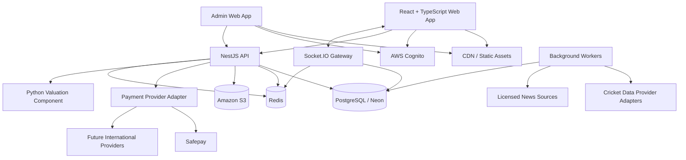
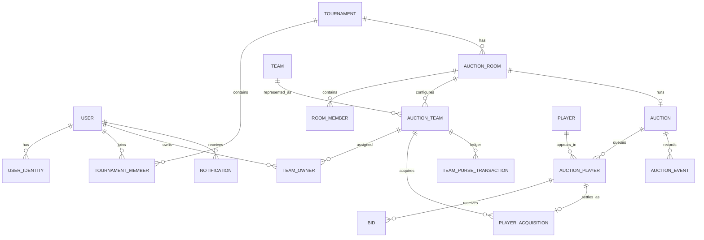

# Under The Hammer — System Architecture

**Status:** Proposed baseline  
**Version:** 1.0  
**Date:** 2026-11-03

---

## 1. Architecture goals

The system must support a global cricket information product and a real-time multiplayer auction platform without coupling every feature to one giant application module.

Primary goals:

- Reliable, server-authoritative auctions.
- Normalized PostgreSQL data with primary and foreign keys.
- Clear boundaries between identity, teams, players, auctions, billing, content and administration.
- Real-time communication isolated by room and permission.
- User-uploaded team logos handled safely through object storage.
- Provider-independent payment and cricket-data integrations.
- An admin application capable of handling normal operations without production database edits.
- A modular architecture that can scale without starting with unnecessary microservices.

## 2. Recommended system shape

Start with a **modular monolith** for the NestJS API, plus a separate Python valuation component if the existing Python code remains independently useful. Deploy components independently only where operational needs justify it.



Neon is the proposed PostgreSQL hosting option. Use its supported connection approach and connection pooling appropriate to the deployment environment. Do not assume a database vendor-specific feature where ordinary PostgreSQL behavior is sufficient.

## 3. Application boundaries

### 3.1 Public web application

React + TypeScript frontend with:
- Home and About
- News
- Live cricket
- Player directory and profiles
- Auction marketing page
- Authentication screens
- Authenticated auction entry experience
- Live auction room
- Account and billing views

The user requested React + TypeScript, GSAP and Framer Motion. A framework decision remains: use Next.js if server rendering, metadata and SEO are priorities; otherwise use React with a routing/build setup. The product requirements favor SEO-friendly public content, so **Next.js with React and TypeScript is recommended**, but the implementation must not mix multiple competing app frameworks.

### 3.2 Admin application

A separate route group or separate frontend application with:
- Staff authentication and MFA policy
- Permission-aware navigation
- Support case queue
- User, room, auction, payment and content tools
- Notifications
- Audit trail

The admin app must call authorized backend operations. It must not connect directly to PostgreSQL from the browser.

### 3.3 NestJS modules

Recommended module boundaries:

```text
apps/api/src/modules/
  identity/
  users/
  teams/
  files/
  players/
  player-stats/
  cricket-data/
  news/
  live-matches/
  tournaments/
  subscriptions/
  rooms/
  invitations/
  team-allocation/
  auctions/
  bidding/
  auction-events/
  squads/
  room-chat/
  payments/
  notifications/
  support/
  moderation/
  admin/
  audit/
```

Modules own their domain rules and expose application services. Avoid circular imports and direct cross-module database manipulation. Shared operations should be exposed through explicit services or domain events.

## 4. Identity and authorization

### AWS Cognito

Cognito is the identity provider for:
- Email/password sign-up and sign-in
- Email verification
- Password reset
- Google federation/sign-in
- Token issuance and refresh

The backend validates Cognito JWTs using issuer, audience/client ID, signature and token-use checks. Do not trust a user ID supplied in the request body.

### Application user mapping

`User.id` is the internal primary key. Store Cognito's stable subject in a unique `UserIdentity` record. Email is a mutable attribute, not a primary key.

A user may hold different room-level roles in different rooms. Global roles and room roles must remain separate.

### Session handling

Use secure, HTTP-only cookies where the chosen web authentication flow supports them. Define CSRF protection for cookie-authenticated state-changing requests. Avoid storing long-lived tokens in localStorage. The exact Cognito OAuth flow, callback design and cookie strategy must be implemented and security-reviewed as one coherent design.

## 5. Data architecture

PostgreSQL is the source of truth for durable application data.

Principles:
- Normalized relational entities.
- Primary keys on all entities.
- Foreign keys for relationships.
- Unique constraints for identity and business invariants.
- Check constraints where useful.
- Transactions for bids, settlement, purse and payment ledger changes.
- Explicit indexes for room lookup, player search, event ordering and user history.
- JSONB only for genuinely flexible configuration or provider payload snapshots, not as a replacement for relational modeling.

### Core relationship overview



The diagram is conceptual. The detailed Prisma schema must specify all fields, delete behavior, unique constraints and indexes.

## 6. Auction domain and state machine

The auction engine is the most critical domain. It owns:
- Auction lifecycle
- Current player
- Player queue
- Current phase
- Bid validation
- Bid increment calculation
- Timer deadlines
- Break scheduling
- Turn order
- Settlement
- Purse and squad effects

### State model

Recommended states:

```text
DRAFT
  -> REGISTRATION
  -> READY
  -> LIVE
       -> PLAYER_INTRODUCTION
       -> BIDDING
       -> BREAK
       -> SETTLEMENT
       -> PLAYER_INTRODUCTION (next player)
       -> COMPLETED
  -> PAUSED (where allowed)
  -> CANCELLED (with policy and audit)
```

Do not treat a browser countdown as the timer. Persist the server deadline and phase version. Clients calculate a display countdown from the server timestamp and reconcile when new state arrives.

### Auction modes

Represent auction control and auction format as separate configuration dimensions:

- `controlMode`: `HOST_CONTROLLED` | `SYSTEM_AUTOMATIC`
- `format`: `LIVE_COUNTDOWN` | `TURN_BASED`
- `playerSelectionMode`: `MANUAL` | `AUTOMATIC_DRAW`

This allows a host-controlled countdown auction, an automatic countdown auction, a host-controlled turn-based auction, or an automatic turn-based auction. The host's ability to participate as a team owner is a separate setting and permission.

### Bid processing

A bid command should include:
- Auction/player identifier
- Team identifier
- Proposed amount or requested next valid amount
- Client-generated idempotency key
- Expected auction state version

The server:
1. Authenticates the user.
2. Confirms room membership and team ownership.
3. Locks or serializes the relevant auction/player/team purse state.
4. Confirms the auction is accepting bids and server deadline has not passed.
5. Computes the expected minimum bid from the server's bracket configuration.
6. Checks purse and squad constraints.
7. Inserts the bid and updates the current high bid atomically.
8. Increments the auction state version and event sequence.
9. Commits.
10. Broadcasts the accepted event.

Use a transaction with appropriate row locks or a carefully designed optimistic concurrency/version check. Redis alone must not be the financial source of truth.

### Settlement

Settlement must atomically:
- Mark the player sold or unsold.
- Record the winning bid.
- Create the acquisition.
- Create a purse ledger debit.
- Update the squad.
- Advance the auction state.
- Write an ordered event.

If the transaction fails, no partial settlement is allowed. Settlement must be idempotent.

### Turn-based mode

Turn-based mode has a separate turn state:
- Current eligible team
- Turn order
- Action allowed (`RAISE`, `PASS`, potentially `HOLD` if defined)
- Turn deadline
- Teams still active in the bidding contest
- Completion rule

The precise rules for pass/re-entry and final settlement must be documented before coding. Do not infer them from countdown mode.

## 7. Real-time architecture

Use Socket.IO for room-level real-time events.

### Connection flow

1. Client obtains a valid authenticated session/token.
2. Socket connection is authenticated by the backend.
3. Client requests to join a room.
4. Backend checks room visibility, membership, spectator policy and account status.
5. Backend joins the socket to a server-controlled channel.
6. Backend sends an authoritative state snapshot.
7. Server broadcasts subsequent events to authorized room channels.

Never let a client subscribe to an arbitrary socket room name without authorization.

### Event channels

Keep room events scoped by room and permission:
- `room:{roomId}:public`
- `room:{roomId}:owners`
- `room:{roomId}:host`
- `room:{roomId}:staff` (only if required)

Do not send private account, payment or moderation data to public room channels.

### Event envelope

Every server event should include a consistent envelope:

```ts
type RealtimeEnvelope<T> = {
  eventId: string;
  roomId: string;
  auctionId?: string;
  sequence: number;
  stateVersion: number;
  occurredAt: string;
  type: string;
  payload: T;
};
```

Use sequence numbers to detect missed events. On reconnect or a sequence gap, client requests a fresh snapshot and resumes from the latest sequence supported by the backend.

### Redis

Redis may support:
- Socket.IO adapter across API instances
- Short-lived coordination and cache
- Rate-limit counters
- Job queues or ephemeral locks where justified

Persist auction state, bids, purse transactions and event history in PostgreSQL. Redis loss must not erase the auction ledger.

## 8. Break and timer behavior

Persist:
- Phase start timestamp
- Phase deadline
- Configured duration
- Reason for transition
- Host adjustment event
- Current bid count relevant to break rules

A host extension or reduction is a command validated by the backend and audited. The client never directly edits the deadline.

The product's current proposed break rule is a short configurable break after every five accepted bids. The exact counter scope (per player vs entire auction) remains an open product decision. Implement this as configuration rather than embedding the assumption in code.

## 9. Team and squad rules

An `AuctionTeam` is a team instance within one auction, not necessarily the same as a global reusable `Team` definition.

The global `Team` record stores identity and logo metadata. The auction-specific team stores:
- Assigned owner
- Purse
- Squad limits
- Category/role/nationality constraints
- Auction-specific display settings

Team allocation modes:
- User-selected: atomic reservation of an available team slot.
- Random: server-side assignment with recorded assignment event and deterministic audit metadata.
- Custom: organizer defines team and owner mapping.

The host may configure purse and squad requirements before auction start. Changes after start require explicit policy, permission and audit. Purse increases during an auction must be recorded as ledger credits, not silent balance overwrites.

## 10. Payments and subscriptions

Create a provider-neutral payment boundary:

```ts
interface PaymentProvider {
  createCheckout(input: CheckoutRequest): Promise<CheckoutSession>;
  verifyWebhook(input: WebhookRequest): Promise<VerifiedPaymentEvent>;
  refund(input: RefundRequest): Promise<RefundResult>;
  getPayment(input: ProviderPaymentLookup): Promise<ProviderPayment>;
}
```

Safepay is the initial Pakistan provider candidate. Confirm current product capabilities, settlement currency, webhook behavior, refund support and merchant eligibility before implementation. Future international providers implement the same interface.

Keep separate records for:
- Host subscription
- Tournament entry payment (if enabled)
- Payment attempt/provider transaction
- Refund
- Invoice/receipt
- Financial ledger entry

A payment callback must be signature-verified and idempotent. Never grant an entitlement solely because the browser returned from a checkout page.

## 11. Files and S3

Use S3 for user-uploaded logos and generated exports where appropriate.

Upload flow:
1. Authenticated client requests an upload intent.
2. Backend checks permission, file category, quota and declared metadata.
3. Backend issues a short-lived presigned upload URL or routes through a controlled upload service.
4. Client uploads.
5. Backend verifies object existence, actual content type, file signature and dimensions.
6. Image is re-encoded/scanned as appropriate.
7. Asset is marked ready and attached to a team.
8. Delivery uses controlled public/private access policy.

Do not accept arbitrary remote image URLs as team logos. Do not store secrets or AWS credentials in the browser.

## 12. Cricket data and news integrations

Create adapters around external providers:
- Player and team data
- Match schedule and live scores
- Scorecards and statistics
- News feeds

Store provider identifiers separately from internal IDs. Keep provider payload snapshots only where contractually permitted and useful for diagnostics. Track:
- Source
- Fetched timestamp
- Provider update timestamp
- Data freshness
- License/usage restrictions
- Ingestion status

Public pages should display attribution and last-updated information. Provider failure must not make the whole site unavailable.

## 13. Notifications and background jobs

Use a background worker/queue for:
- Email verification-related application notifications
- Auction invitations
- Auction reminders
- Subscription lifecycle notifications
- Payment reconciliation
- News and match data ingestion
- Scheduled maintenance announcements
- Export generation
- Retention and cleanup tasks

In-app notifications are persisted in PostgreSQL and delivered in real time through Socket.IO. Email delivery is a separate channel with preferences and delivery status.

## 14. Admin architecture

Admin UI actions call explicit admin endpoints. Each action checks:
- Staff identity
- Granular permission
- Target resource scope
- Reason/comment where required
- Approval requirement
- Current resource state

Write an append-only audit record for every sensitive action. Use compensating transactions for financial corrections and auction corrections; do not rewrite historical ledger entries.

## 15. Deployment and environments

Environments:
- Local development
- Shared development/staging
- Production

Use environment-specific Cognito pools/app clients, databases, S3 buckets, payment credentials and data-provider credentials. Production secrets belong in a managed secret store.

Initial deployment can use containerized web/API/worker processes, Neon PostgreSQL, Redis and S3. Choose hosting based on WebSocket support, connection duration, region latency, operational cost and deployment reliability. Confirm that the chosen platform supports long-lived WebSocket connections and background workers.

## 16. Scaling path

Start with:
- One modular NestJS API deployment
- One worker deployment
- One Socket.IO gateway (can be same API initially)
- PostgreSQL
- Redis adapter when multiple socket instances are deployed

Scale by extracting workloads only when metrics justify it:
- Real-time gateway
- Cricket ingestion
- News ingestion
- Export rendering
- Payment reconciliation

Do not introduce microservices merely to appear scalable.

## 17. Security baseline

- Validate Cognito JWTs server-side.
- Use least-privilege AWS IAM.
- Enforce authorization at service boundaries.
- Validate all inputs with DTO/schema validation.
- Rate-limit authentication, bid, chat, invitation and upload endpoints.
- Sanitize chat content and prevent stored XSS.
- Use CSRF protections where cookie sessions require them.
- Verify payment webhooks.
- Use private S3 buckets and scoped presigned URLs.
- Keep audit logs for privileged operations.
- Do not log passwords, tokens, payment secrets or sensitive personal data.
- Apply room-level access checks to every REST and socket operation.
